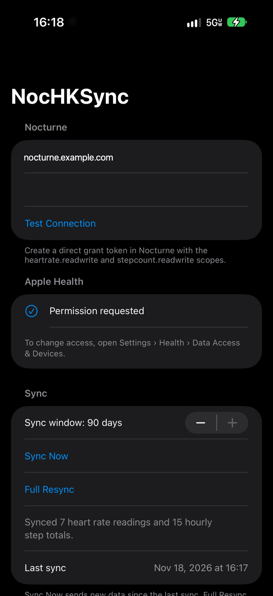
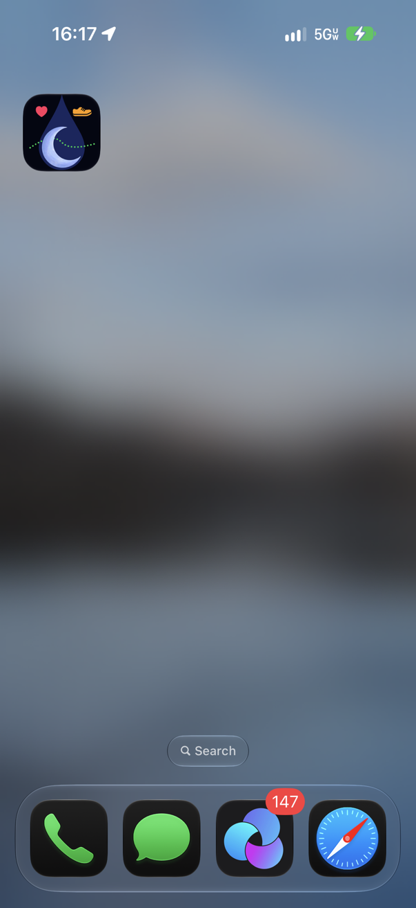

# NocHKSync

NocHKSync is a small iPhone app that copies your **steps** and **heart rate** from Apple Health into your own [Nocturne](https://getnocturne.dev) server. It lets you see activity next to your glucose, insulin, and meal data in one place.

It is a personal, single-purpose tool. It has no accounts, no analytics, and no third-party services. Data goes straight from your phone to the Nocturne server you point it at.

## Screenshots

| Connect to Nocturne, grant Health access, and sync | The app icon on the home screen |
| :---: | :---: |
|  |  |

## What is Nocturne?

[Nocturne](https://getnocturne.dev) is an open-source diabetes data platform developed under the [Nightscout](https://nightscout.github.io) GitHub organization ([source](https://github.com/nightscout/nocturne)). Nightscout is the long-running community project for getting continuous glucose monitor (CGM) data into the cloud. Nocturne is a ground-up rewrite of the Nightscout server:

- **Nightscout compatible.** It implements the Nightscout API, so existing uploaders and apps keep working.
- **Built-in connectors.** It can pull data from services like Dexcom Share, LibreLinkUp, MiniMed CareLink, Glooko, and others.
- **Modern stack.** It is built on .NET with PostgreSQL, real-time updates, and reports such as time in range.
- **Health data beyond diabetes.** It has native storage for heart rate and step counts, which show up on its charts. NocHKSync uses that.

You run Nocturne yourself or use a hosted instance. If you are new to it, start at [getnocturne.dev](https://getnocturne.dev) and get a server running before using this app.

## What the app does

- Reads heart rate and step count from Apple Health, with read-only permission.
- Uploads up to the last 90 days on first sync. The window is adjustable.
- After that, uploads only what is new.
- Optionally syncs in the background about once a day, retries on failure, and notifies you after 3 failures in a row.

Data mapping:

| Apple Health | Nocturne | Notes |
|---|---|---|
| Heart rate samples | `POST /api/v4/HeartRate` | Every sample, from every source such as Apple Watch or Oura |
| Step count | `POST /api/v4/StepCount` | One total per hour. Apple Health merges overlapping iPhone, Watch, and ring data so steps are not double counted. |

Every record is tagged with data source `apple-health` and a stable sync ID. Nocturne updates matching records instead of duplicating them, so re-syncing is safe.

Things to know:

- **Heart rate volume is high.** An Apple Watch records heart rate every few minutes, so a 90-day first sync can be well over 100,000 readings. Later syncs are small.
- **Nocturne does not deduplicate across sources for heart rate and steps.** If you also import the same data another way, such as Nocturne's Oura export import, it will be counted twice.

## Requirements

- An iPhone on iOS 17 or later.
- A Mac with Xcode. The project was built with Xcode 27.
- An Apple Developer account. The app uses HealthKit and HealthKit background delivery. It has only been tested with a paid membership.
- A recent Nocturne server with the v4 heart rate and step count endpoints. The app's Test Connection button tells you if they are missing.

## Setup

### 1. Create a Nocturne token

In your Nocturne web app, create a **direct grant** API token with these two scopes:

- `heartrate.readwrite`
- `stepcount.readwrite`

Copy the token, which starts with `noc_`. Nocturne only shows it once.

### 2. Build the app

```sh
git clone https://github.com/loudestnoise/NocHKSync.git
cd NocHKSync
cp Local.xcconfig.example Local.xcconfig
```

Edit `Local.xcconfig` with your Apple Developer team ID and a bundle identifier you own. That file is gitignored. Then open `NocHKSync.xcodeproj`, choose your iPhone, and press Run. Xcode's automatic signing sets up the HealthKit capability.

### 3. Connect

1. Enter your Nocturne address. A bare host like `nocturne.example.com` works. The app tries HTTPS first and only falls back to HTTP for local network addresses.
2. Paste the token and tap **Test Connection**.
3. Tap **Allow Access to Steps and Heart Rate**.
4. Tap **Sync Now**.
5. Optionally turn on **Daily background sync**, and check that Background App Refresh is on for the app in iOS Settings.

The token is stored in the iOS Keychain.

## Background sync

Two triggers wake the app:

- **HealthKit background delivery.** It fires at most once a day when new heart rate or step data arrives.
- **A background app refresh task.** It is scheduled daily as a safety net, and sooner after a failure.

An automatic sync is skipped if the last success was under 20 hours ago. A failure retries after 30 minutes, then 1, 2, 4, and 6 hours. A locked phone is not counted as a failure, because Health data cannot be read until the phone is unlocked. iOS decides the actual timing.

To fire the refresh task while debugging, pause the app in Xcode and run this in the debugger console, replacing the bundle ID with yours:

```
e -l objc -- (void)[[BGTaskScheduler sharedScheduler] _simulateLaunchForTaskWithIdentifier:@"com.yourname.NocHKSync.refresh"]
```

## Not supported

- Nightscout API secret authentication. Only Nocturne Bearer tokens are supported.
- Data types other than heart rate and steps.

## Disclaimer

This is an independent hobby project. It is not affiliated with or endorsed by the Nocturne or Nightscout projects, or by Apple. It is not a medical device and must not be used for medical decisions.

## Credits and license

- The app icon is built from the **Nocturne logo**, which belongs to the [Nocturne](https://getnocturne.dev) project. It is used here with attribution only, to show which server the app talks to. It is not covered by this repository's license. The heart and shoe are Apple SF Symbols.
- The code is released under the [MIT License](LICENSE).
